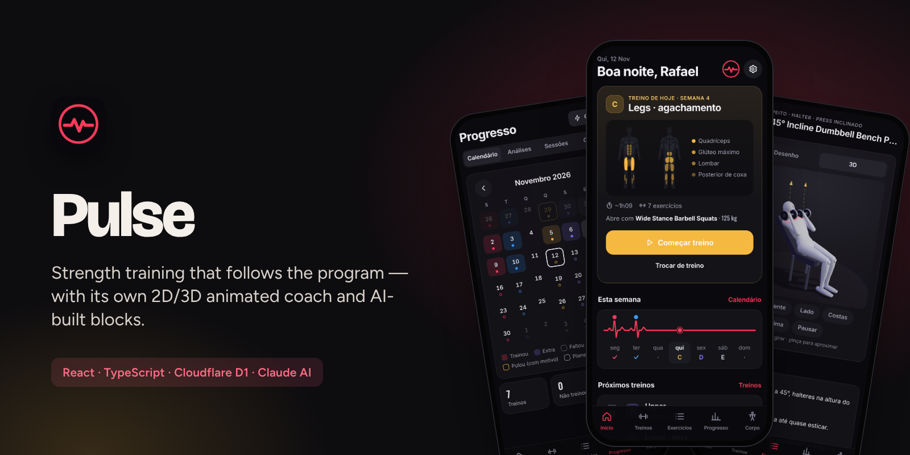
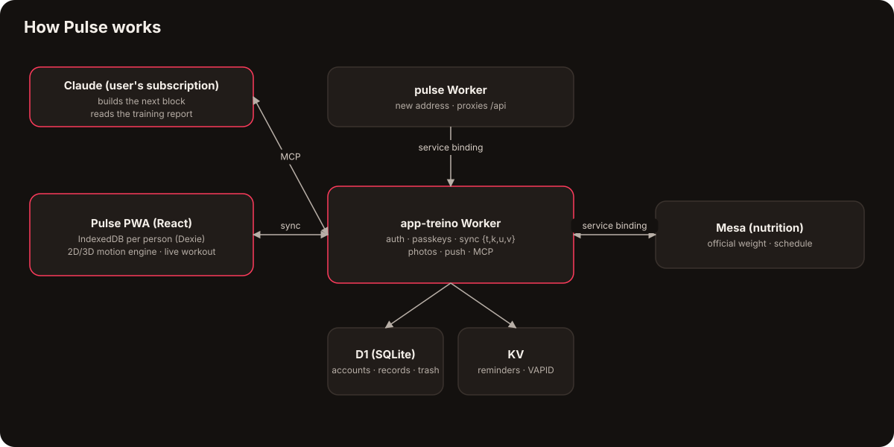

  <a href="https://bebernos.github.io/Pulse-Business/"><b>▶ Live demo</b></a> ·
  <a href="README.pt-BR.md">Leia em português</a> ·
  <a href="#how-it-works">Architecture</a> ·
  <a href="SECURITY.md">Security</a> ·
  <a href="docs/case-study.md">Case study</a>

  
  

# Pulse

**Pulse is a strength-training app (PWA) that turns a structured program into today's workout, logs every set, explains
every exercise with its own 2D/3D animation, and hands the results back to an AI coach (Claude) to build the next block.**

It was built for a real athlete and is used at the gym every training day: 24 releases, two accounts in the household,
programs of 13 weeks with deloads and supersets, and an offline-first design that never loses a set — even with no
signal in the gym's basement.

> The live demo runs with a **fictitious athlete** (Rafael) in week 4 of a 13-week block, generated in your browser with
> dates that always move with today's calendar. No account, no server — nothing leaves your browser.

## What it does

| | | | |
|:---:|:---:|:---:|:---:|
|  **Today's workout & muscles** |  **Live workout, set by set** |  **Every exercise in 3D** |  **The program, week by week** |
|  **Calendar & adherence** |  **Body composition** |  **Analyze with AI** |  **Accounts & settings** |

 
<i>Start today's workout, tick the sets — a personal record pops up on the spot — then progress and body.</i>

- **Training** — the week's prescription (sets, reps, RIR, rest, deload, supersets A1/A2, warm-up, cardio targets,
  mobility), a rest timer, "same as last time", plate math for the gym's plates, list mode or one-big-set mode, exercise
  swaps with suggested substitutes, instant personal records (estimated 1RM).
- **A notification that coaches** — while the phone is locked, the live workout shows the rest ring, the current exercise
  and "set done" / "+15 s" buttons.
- **The exercise library** — 300+ exercises (strength, mobility, cardio, Pilates, functional) with how-to text in English
  and Portuguese and **hand-made animations**: a 2D articulated figure and a 3D view generated from the same motion data.
- **Progress & body** — calendar (done / missed / skipped with reason), weekly adherence, real volume per muscle against
  targets, block-vs-block comparison, load history, weight with a 7-day average, measurements on a body map, body-fat
  estimate (Navy / RFM), lean mass, FFMI, progress photos.
- **AI where it adds judgment** — a structured training report goes to Claude; an **MCP connector** lets the user's own
  Claude read the context and publish the next program after validation and the user's approval. No paid API.

## How it works

The unusual part: **the exercise animations are generated, not filmed.** A small motion engine
([`src/lib/motion/`](src/lib/motion)) describes each movement family (bench, barbell, cable, machine, unilateral,
alternating) with parameters and key poses, solves the limbs with two-bone inverse kinematics and draws a 2D figure with
the target muscles highlighted. The 3D view ([`src/lib/motion3d/`](src/lib/motion3d), three.js, loaded on demand) converts
the same frames into bone directions and skins a smooth body whose muscles are painted by a shader. One table maps the
300+ exercises to their motion; a test makes sure no exercise is left without one.

Data is **offline-first**: every person has their own IndexedDB; a Dexie middleware stamps every write and leaves a
tombstone on delete, and the Worker syncs batches of `{t, k, u, v}` records (highest timestamp wins) into D1, with a
3-day trash that can restore a deleted workout with all its sets.

## Security

Passwords never leave the device: the app derives a key with PBKDF2-SHA256 (600k iterations) and the server stores only a
hash of it. Sessions live in `HttpOnly; Secure; SameSite=Strict` cookies, passkeys (WebAuthn) are verified with
SimpleWebAuthn, and every row in D1 carries the owner's `user_id`. Details in [SECURITY.md](SECURITY.md).

## Engineering highlights

- **506 tests** (Vitest): calendar, prescription, plates, analytics, body composition, the plan schema, translation
  coverage, motion data for every exercise, the Worker against a D1 on `node:sqlite`, and IndexedDB with `fake-indexeddb`.
- **Data never gets lost** — local format changes are copy-and-verify migrations, never in-place rewrites; the previous
  app's database is migrated and checked, never altered.
- **Serverless on the free tier** (~10 ms CPU per request) — heavy work (password derivation, reminder scheduling) runs on
  the device; the Worker only verifies, stores and fires.
- **Two languages per account** (EN/PT), with everything sent to the AI kept in Portuguese by design.
- **Gestures without libraries** — long-press to reorder, swipe to delete with undo, all with keyboard and screen-reader
  equivalents.

## Tech stack

React 19 · TypeScript · Vite · Dexie (IndexedDB) · Zod · three.js · Workbox · SimpleWebAuthn · Cloudflare Workers · D1 · KV ·
Cron Triggers · Web Push · Model Context Protocol (MCP) · Claude · Vitest · Playwright

## Read more

- [Case study](docs/case-study.md) — the problem, the decisions and what came out of them.
- [Security](SECURITY.md) — threat model and how each layer works.
- [Plan format](docs/FORMATO-PLANO.md) and [analysis format](docs/FORMATO-ANALISE.md) — the contracts with the AI (Portuguese).

## The suite

| | |
|---|---|
| [**Lastro**](https://github.com/BeBernos/Lastro-Business) | Family finance hub — cash flow, credit card and investments, encrypted end to end |
| [**Mesa**](https://github.com/BeBernos/Mesa-Business) | Family nutrition plan, planned by AI |
| **Pulse** | Strength training (this repository) |
| [**Cesta**](https://github.com/BeBernos/Cesta-Business) | Grocery price research, shopping route and receipt audit |

## About

Designed and built by **Bruno Bernos** — product, UX and engineering — working with Claude Code as a pair programmer.
Contact: [github.com/BeBernos](https://github.com/BeBernos).

## License

Copyright © 2026 Bruno Bernos. **All rights reserved.** The source is published for evaluation only; no permission is
granted to use, copy, modify or distribute it. Commercial licenses (gyms, personal trainers, coaching platforms, and the
exercise animation engine on its own) are available — see [LICENSE](LICENSE) and get in touch.
