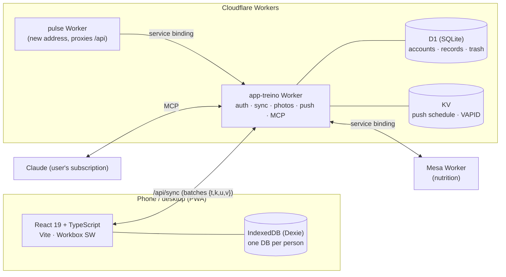

<p align="center"></p>

<h1 align="center">Pulse</h1>
<p align="center"><b>Strength training that follows the program — offline first, synced everywhere, with its own animated coach.</b></p>

<p align="center">
  <a href="README.pt-BR.md">🇧🇷 Leia em português</a> ·
  <a href="#demo">Demo</a> ·
  <a href="#architecture">Architecture</a> ·
  <a href="#commercial-use">Commercial use</a>
</p>

<p align="center">
  
  
  
  
  
  
</p>

---

Pulse is a progressive web app for people who train with a structured program. The program (blocks, weeks, deloads,
supersets, warm-ups, cardio and mobility) is written by an AI assistant from a documented JSON contract; the app turns it
into today's workout, logs every set, explains every exercise with its own 2D/3D animation, and sends the results back to
the assistant to plan the next block.

> All data in this repository and in the images is fictitious (demo account: Rafael).

## Demo

<p align="center"></p>

| Home | Program | Live workout | Exercise in 3D |
|---|---|---|---|
|  |  |  |  |

| Progress | Body composition | Analyze with AI | Settings |
|---|---|---|---|
|  |  |  |  |

**Desktop** — side menu, list and detail side by side:


## What it does

**Training**
- Today's workout from the active program (weekly split or rotation), with the prescription of the current week:
  sets, reps, RIR, rest, deload, supersets (A1/A2), warm-up, cardio targets and mobility blocks.
- Live workout: rest timer, "same as last time", plate math for the gym's plates, list or one-big-set mode, swap an
  exercise for a suggested substitute, notes, pain markers, instant personal records (estimated 1RM).
- A live notification with the rest ring, current exercise and "set done" / "+15 s" buttons while the phone is locked.

**Exercise library**
- 300+ exercises (strength, mobility, cardio, Pilates, functional) with how-to text in English and Portuguese.
- **Hand-made animations, no third-party media:** a 2D articulated figure (two-bone inverse kinematics, keyframed
  repetition cycles, muscles highlighted) and a **3D** view (three.js) generated from the same motion data, with
  orbit, zoom and camera presets.

**Progress & body**
- Calendar (done / missed / skipped with reason), weekly adherence, streaks, real volume per muscle against targets,
  block-vs-block comparison, load history per exercise.
- Body: weight with 7-day moving average, measurements on a body map, body-fat estimate (Navy / RFM), lean mass, FFMI,
  progress photos synced to the server.

**AI in the loop, without a paid API**
- "Analyze with Claude": shares a structured training report and stores the pasted analysis.
- An **MCP connector** lets the user's own Claude read the training context and publish the next program after
  validation and the user's approval.

**Accounts & household**
- Private accounts per person, invitations, passkeys (fingerprint), sign-in with a 6-letter code from another device.
- Offline-first sync of every table, trash with restore, automatic data-safe migration from the previous app version.
- Private bridge to [Mesa](https://github.com/BeBernos/Mesa-Business) (family nutrition): one official body weight,
  "did you train today?", cardio calories and the training schedule.

## Architecture



- **Client:** React 19 + TypeScript + Vite, hash router, no CSS framework (design tokens). Dexie middleware stamps every
  write and leaves tombstones on delete, so sync is "highest timestamp wins" per record.
- **Plan contract:** validated with Zod ([`docs/FORMATO-PLANO.md`](docs/FORMATO-PLANO.md)); analysis format in
  [`docs/FORMATO-ANALISE.md`](docs/FORMATO-ANALISE.md).
- **Server:** Cloudflare Workers on the free plan (≈10 ms CPU per request): password hashing is derived on the device,
  WebAuthn verified with SimpleWebAuthn, reminders computed on the device and fired by a cron.
- **i18n:** English and Portuguese per account; everything sent to the AI stays in Portuguese by design.

## Quality

- **506 tests** (Vitest): pure training logic (calendar, prescription, plates, analytics, body), plan schema, i18n
  coverage, motion data for every exercise, the Worker against an in-memory D1 on `node:sqlite`, and IndexedDB with
  `fake-indexeddb`.
- End-to-end script with Playwright and a virtual authenticator: migration, account activation, passkey, invite,
  two-device sync including offline.
- `npm run ci` (tests + production build) is the build command used for deployment.

## Run it locally

```bash
npm install
npm run dev            # app only, http://localhost:5173
npm test               # 506 tests
npm run build          # dist/
npx wrangler dev --local --var PULSO_SETUP:choose-a-setup-code   # app + API on http://localhost:8787
```

## Commercial use

This repository is **source-available, not open source**: you may read and evaluate the code, but production or commercial
use requires a license. Licenses are available for **white-label deployments** (gyms, personal trainers, coaching
platforms, corporate wellness) and custom development — including the exercise animation engine. See [LICENSE](LICENSE)
and get in touch through [github.com/BeBernos](https://github.com/BeBernos).

## Part of a suite

| | |
|---|---|
| [**Mesa**](https://github.com/BeBernos/Mesa-Business) | Family nutrition plan, planned by AI |
| **Pulse** | Strength training (this repository) |
| [**Cesta**](https://github.com/BeBernos/Cesta-Business) | Grocery price research and comparison across stores |
