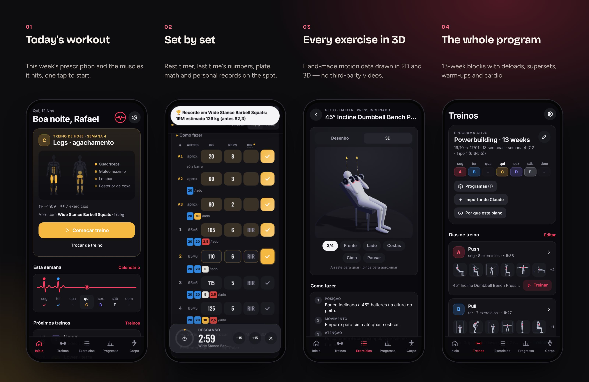
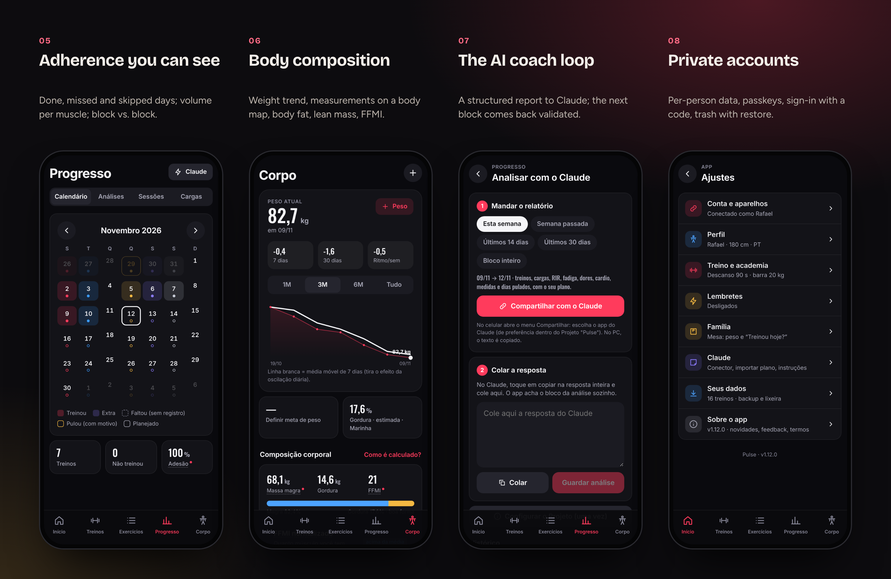
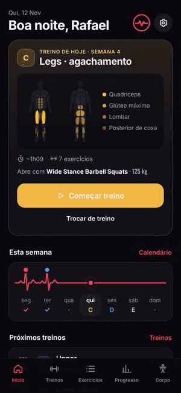
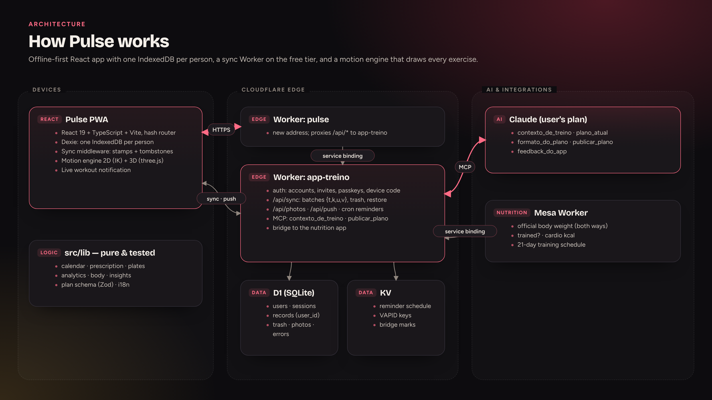
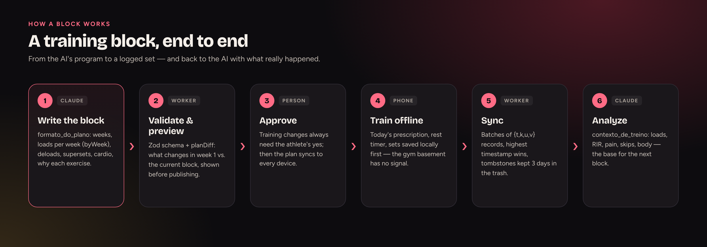

  <a href="https://bebernos.github.io/Pulse-Business/"><b>▶ Live demo</b></a> ·
  <a href="README.pt-BR.md">Leia em português</a> ·
  <a href="#how-it-works">Architecture</a> ·
  <a href="SECURITY.md">Security</a> ·
  <a href="docs/case-study.md">Case study</a>

  
  

# Pulse

**Pulse is a strength-training app (PWA) that turns a structured program into today's workout, logs every set, explains
every exercise with its own 2D/3D animation, and hands the results back to an AI coach (Claude) to build the next block.**

It was built for a real athlete and is used at the gym every training day: 24 releases, two accounts in the household,
programs of 13 weeks with deloads and supersets, and an offline-first design that never loses a set — even with no
signal in the gym's basement.

**At a glance:** 24 releases · 300+ exercises animated in 2D/3D · 506 tests · offline-first · EN/PT per account

> The live demo runs with a **fictitious athlete** (Rafael) in week 4 of a 13-week block, generated in your browser with
> dates that always move with today's calendar. No account, no server — nothing leaves your browser.

## What it does

 <i>Start today's workout, tick the sets — a personal record pops up on the spot — then progress and body.</i>

**In detail**
- **Training** — sets, reps, RIR, rest, deloads, supersets (A1/A2), warm-ups, cardio and mobility from the week's prescription;
  rest timer, "same as last time", plate math, exercise swaps, instant records (estimated 1RM), a live notification.
- **Library** — 300+ exercises with how-to text in English and Portuguese and hand-made 2D/3D animations.
- **Progress & body** — calendar with reasons for skipped days, adherence, volume per muscle vs. targets, block comparison,
  load history, weight average, measurements, body fat (Navy / RFM), lean mass, FFMI, progress photos.
- **Accounts** — private per-person data, passkeys, sign-in with a 6-letter code, a 3-day trash with restore.

## How it works

Pulse is an **offline-first React app**: everything is written to the device first and synced later, because gyms rarely have
signal. Two Workers sit behind it — a thin one at the new address that proxies `/api/*`, and the original one that owns
accounts, sync, photos, reminders, the MCP server and the bridge to the nutrition app.

**On the device** — React 19 + TypeScript + Vite. Each person has their own IndexedDB (Dexie). A middleware stamps every write with a timestamp and a dirty flag and turns deletes into tombstones, so the sync layer only ships what changed. Pure, tested logic lives in `src/lib` (calendar, prescription, plates, analytics, body composition, the plan schema).

**The motion engine** — `src/lib/motion` describes movement families with parameters and key poses and solves limbs with two-bone inverse kinematics; `src/lib/motion3d` turns the same frames into bone directions for a smooth three.js body whose muscles are painted by a shader. One table maps every exercise to its motion, enforced by a test.

**At the edge** — `/api/sync` accepts batches of `{t, k, u, v}` (table, key, timestamp, value) — highest timestamp wins — and copies anything deleted into a 3-day trash first. Auth issues hashed session tokens in strict cookies; passwords arrive already derived on the device (PBKDF2, 600k iterations) to fit the free plan's CPU budget.

**The AI loop** — A structured report (`log@1`) or the MCP tool `contexto_de_treino` gives Claude loads, RIR, pain, skipped days and body data; `publicar_plano` validates the next block with the app's own Zod schema and shows what changes before anything is published.

**Integrations** — Over a service binding, Pulse keeps one official body weight with the nutrition app (Mesa), answers its "did you train today?", sends cardio calories and a 21-day training schedule.

### The flow

### Design decisions

| Decision | Why |
|---|---|
| **Offline first, sync later** | A set must never be lost to a bad signal. |
| **Animations from data, not video** | One consistent style, no licensing, 300+ exercises from a dozen movement families. |
| **Heavy crypto on the device** | The free Workers plan allows ~10 ms of CPU; PBKDF2 at 600k iterations runs on the phone. |
| **Copy-and-verify migrations** | Data never gets lost: old databases are copied and checked, never rewritten in place. |

## Security

Passwords never leave the device: the app derives a key with PBKDF2-SHA256 (600k iterations) and the server stores only a
hash of it. Sessions live in `HttpOnly; Secure; SameSite=Strict` cookies, passkeys (WebAuthn) are verified with
SimpleWebAuthn, and every row in D1 carries the owner's `user_id`. Details in [SECURITY.md](SECURITY.md).

## Engineering highlights

- **506 tests** (Vitest): calendar, prescription, plates, analytics, body composition, the plan schema, translation
  coverage, motion data for every exercise, the Worker against a D1 on `node:sqlite`, and IndexedDB with `fake-indexeddb`.
- **Data never gets lost** — local format changes are copy-and-verify migrations, never in-place rewrites; the previous
  app's database is migrated and checked, never altered.
- **Serverless on the free tier** (~10 ms CPU per request) — heavy work (password derivation, reminder scheduling) runs on
  the device; the Worker only verifies, stores and fires.
- **Two languages per account** (EN/PT), with everything sent to the AI kept in Portuguese by design.
- **Gestures without libraries** — long-press to reorder, swipe to delete with undo, all with keyboard and screen-reader
  equivalents.

## Tech stack

React 19 · TypeScript · Vite · Dexie (IndexedDB) · Zod · three.js · Workbox · SimpleWebAuthn · Cloudflare Workers · D1 · KV ·
Cron Triggers · Web Push · Model Context Protocol (MCP) · Claude · Vitest · Playwright

## Read more

- [Case study](docs/case-study.md) — the problem, the decisions and what came out of them.
- [Security](SECURITY.md) — threat model and how each layer works.
- [Plan format](docs/FORMATO-PLANO.md) and [analysis format](docs/FORMATO-ANALISE.md) — the contracts with the AI (Portuguese).

## The suite

| | |
|---|---|
| [**Lastro**](https://github.com/BeBernos/Lastro-Business) | Family finance hub — cash flow, credit card and investments, encrypted end to end |
| [**Mesa**](https://github.com/BeBernos/Mesa-Business) | Family nutrition plan, planned by AI |
| **Pulse** | Strength training (this repository) |
| [**Cesta**](https://github.com/BeBernos/Cesta-Business) | Grocery price research, shopping route and receipt audit |

## About

Designed and built by **Bruno Bernos** — product, UX and engineering — working with Claude Code as a pair programmer.
Contact: [github.com/BeBernos](https://github.com/BeBernos).

## License

Copyright © 2026 Bruno Bernos. **All rights reserved.** The source is published for evaluation only; no permission is
granted to use, copy, modify or distribute it. Commercial licenses (gyms, personal trainers, coaching platforms, and the
exercise animation engine on its own) are available — see [LICENSE](LICENSE) and get in touch.
