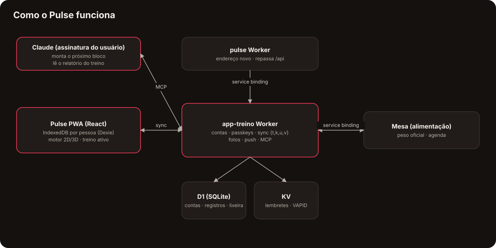

  <a href="https://bebernos.github.io/Pulse-Business/"><b>▶ Demonstração ao vivo</b></a> ·
  <a href="README.md">Read in English</a> ·
  <a href="#como-funciona">Arquitetura</a> ·
  <a href="SECURITY.md">Segurança</a> ·
  <a href="docs/case-study.pt-BR.md">Estudo de caso</a>

  
  

# Pulse

**O Pulse é um app de treino de força (PWA) que transforma um programa estruturado no treino de hoje, registra cada série,
explica cada exercício com uma animação 2D/3D própria e devolve os resultados a um treinador de IA (o Claude) para montar o
próximo bloco.**

Foi feito para um atleta de verdade e é usado na academia em todo dia de treino: 24 versões, duas contas na casa, programas
de 13 semanas com deload e supersets, e um desenho offline primeiro que nunca perde uma série — nem sem sinal no subsolo da
academia.

> A demonstração ao vivo usa um **atleta fictício** (Rafael) na semana 4 de um bloco de 13, gerado no seu navegador com
> datas que sempre acompanham o calendário de hoje. Sem conta, sem servidor — nada sai do seu navegador.

## O que faz

| | | | |
|:---:|:---:|:---:|:---:|
|  **Treino de hoje e músculos** |  **Treino ativo, série por série** |  **Cada exercício em 3D** |  **O programa, semana a semana** |
|  **Calendário e adesão** |  **Composição corporal** |  **Analisar com IA** |  **Contas e ajustes** |

 
<i>Começa o treino de hoje, marca as séries — o recorde aparece na hora — depois progresso e corpo.</i>

- **Treino** — a prescrição da semana (séries, repetições, RIR, descanso, deload, supersets A1/A2, aquecimento, metas de
  cardio, mobilidade), cronômetro de descanso, "igual à última", conta de anilhas da academia, modo lista ou uma série
  grande, troca de exercício com substitutos sugeridos, recorde na hora (1RM estimado).
- **Uma notificação que treina junto** — com o celular travado, o treino ativo mostra o anel do descanso, o exercício da vez
  e os botões "série feita" / "+15 s".
- **A biblioteca** — mais de 300 exercícios (força, mobilidade, cardio, Pilates, funcional) com "como fazer" em português e
  inglês e **animações feitas no próprio app**: um boneco 2D articulado e uma vista 3D gerada dos mesmos dados de movimento.
- **Progresso e corpo** — calendário (feito / faltou / pulou com motivo), adesão semanal, volume real por músculo contra a
  meta, comparação entre blocos, histórico de cargas, peso com média de 7 dias, medidas num mapa do corpo, % de gordura
  estimado (Marinha / RFM), massa magra, FFMI, fotos de progresso.
- **IA onde ela acrescenta julgamento** — um relatório estruturado do treino vai para o Claude; um **conector MCP** deixa o
  Claude do próprio usuário ler o contexto e publicar o próximo programa depois da validação e da aprovação. Sem API paga.

## Como funciona

O diferente: **as animações dos exercícios são geradas, não filmadas.** Um pequeno motor de movimento
([`src/lib/motion/`](src/lib/motion)) descreve cada família de movimento (banco, barra, cabo, máquina, unilateral,
alternado) com parâmetros e poses-chave, resolve os membros com cinemática inversa de dois ossos e desenha um boneco 2D com
os músculos-alvo em destaque. A vista 3D ([`src/lib/motion3d/`](src/lib/motion3d), three.js, carregado só quando abre)
converte os mesmos quadros em direções de ossos e veste um corpo liso cujos músculos são pintados por shader. Uma tabela liga
os 300+ exercícios ao seu movimento; um teste garante que nenhum fica sem.

Os dados são **offline primeiro**: cada pessoa tem o próprio IndexedDB; um middleware do Dexie carimba cada gravação e deixa
lápide ao apagar, e o Worker sincroniza lotes de registros `{t, k, u, v}` (vence o carimbo maior) no D1, com uma lixeira de
3 dias que devolve um treino apagado com todas as séries.

## Segurança

A senha nunca sai do aparelho: o app deriva uma chave com PBKDF2-SHA256 (600 mil rodadas) e o servidor guarda só um hash
dela. A sessão fica em cookies `HttpOnly; Secure; SameSite=Strict`, as passkeys (WebAuthn) são conferidas com
SimpleWebAuthn e toda linha do D1 leva o `user_id` do dono. Detalhes em [SECURITY.md](SECURITY.md).

## Destaques de engenharia

- **506 testes** (Vitest): calendário, prescrição, anilhas, análises, composição corporal, schema do plano, cobertura de
  tradução, dados de movimento de todos os exercícios, o Worker contra um D1 sobre `node:sqlite` e o IndexedDB com
  `fake-indexeddb`.
- **Dados nunca se perdem** — mudança de formato local é migração por cópia conferida, nunca transformação no lugar; o banco
  da versão anterior do app é migrado e conferido, nunca alterado.
- **Serverless no plano grátis** (~10 ms de CPU por pedido) — o trabalho pesado (derivar a senha, agendar lembretes) roda no
  aparelho; o Worker só confere, guarda e dispara.
- **Dois idiomas por conta** (PT/EN), e tudo o que vai para a IA fica em português, de propósito.
- **Gestos sem biblioteca** — segurar para reordenar, deslizar para apagar com desfazer, tudo com equivalente por teclado e
  leitor de tela.

## Tecnologias

React 19 · TypeScript · Vite · Dexie (IndexedDB) · Zod · three.js · Workbox · SimpleWebAuthn · Cloudflare Workers · D1 · KV ·
Cron Triggers · Web Push · Model Context Protocol (MCP) · Claude · Vitest · Playwright

## Para ler mais

- [Estudo de caso](docs/case-study.pt-BR.md) — o problema, as decisões e o que saiu delas.
- [Segurança](SECURITY.md) — modelo de ameaças e como cada camada funciona.
- [Formato do plano](docs/FORMATO-PLANO.md) e [formato da análise](docs/FORMATO-ANALISE.md) — os contratos com a IA.

## O conjunto

| | |
|---|---|
| [**Lastro**](https://github.com/BeBernos/Lastro-Business) | Finanças da família — caixa, cartão e investimentos, com criptografia de ponta a ponta |
| [**Mesa**](https://github.com/BeBernos/Mesa-Business) | Plano alimentar da família, montado por IA |
| **Pulse** | Treino de força (este repositório) |
| [**Cesta**](https://github.com/BeBernos/Cesta-Business) | Pesquisa de preços de mercado, rota de compra e conferência da nota |

## Sobre

Concebido e construído por **Bruno Bernos** — produto, UX e engenharia — com o Claude Code como par de programação.
Contato: [github.com/BeBernos](https://github.com/BeBernos).

## Licença

Copyright © 2026 Bruno Bernos. **Todos os direitos reservados.** O código está publicado só para avaliação; não há
permissão para usar, copiar, modificar ou distribuir. Há licenças comerciais (academias, personal trainers, plataformas de
consultoria e o motor de animação dos exercícios sozinho) — veja a [LICENSE](LICENSE) e fale comigo.
