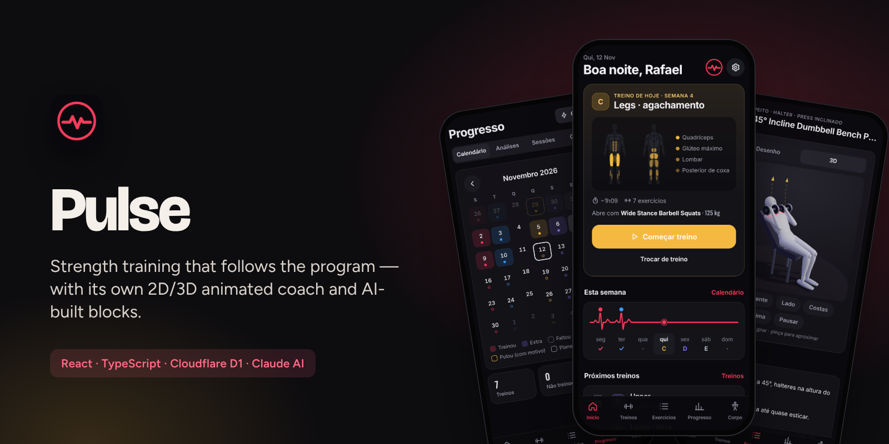
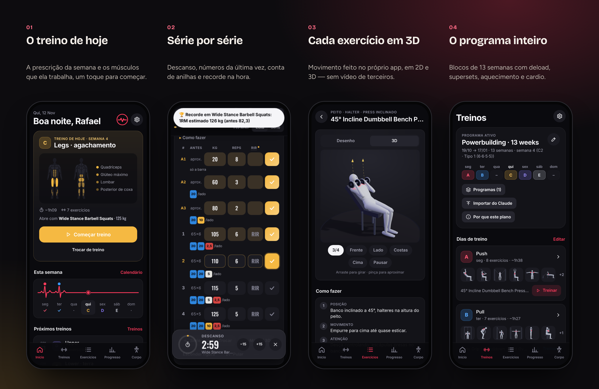
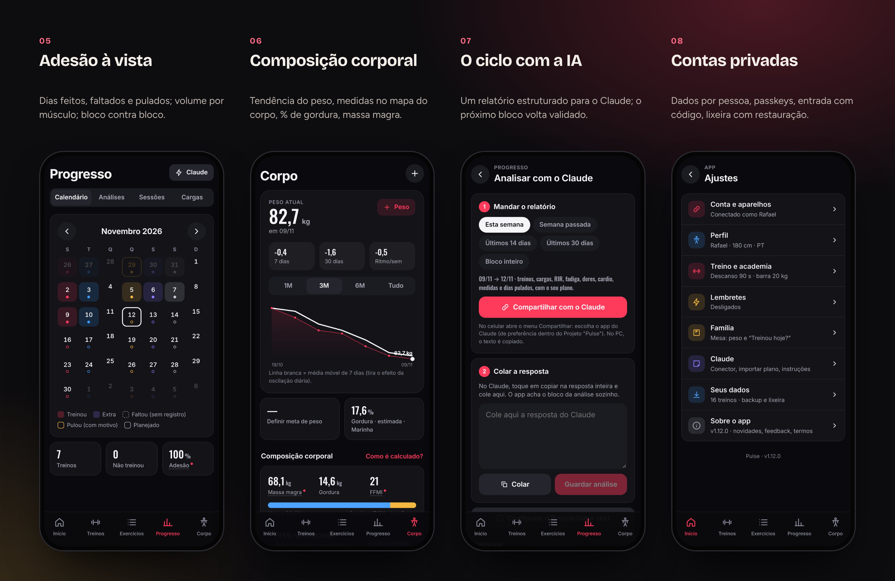
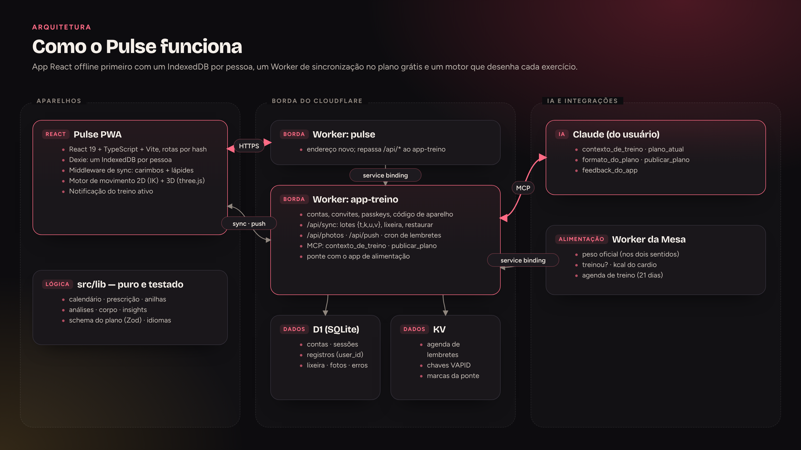
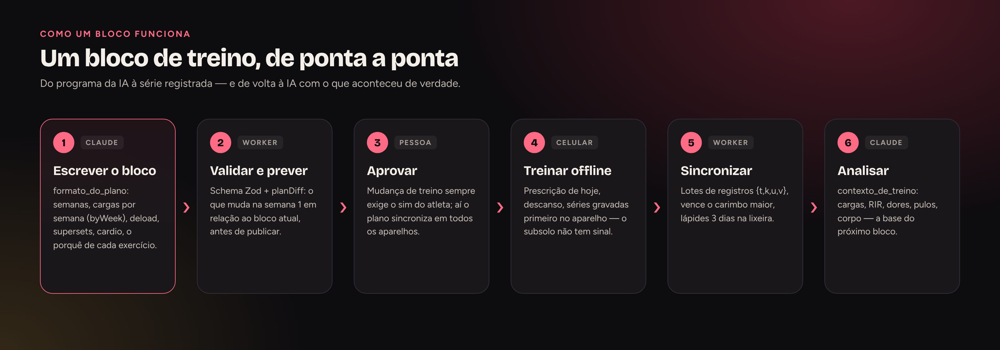

  <a href="https://bebernos.github.io/Pulse-Business/"><b>▶ Demonstração ao vivo</b></a> ·
  <a href="README.md">Read in English</a> ·
  <a href="#como-funciona">Arquitetura</a> ·
  <a href="SECURITY.md">Segurança</a> ·
  <a href="docs/case-study.pt-BR.md">Estudo de caso</a>

  
  

# Pulse

**O Pulse é um app de treino de força (PWA) que transforma um programa estruturado no treino de hoje, registra cada série,
explica cada exercício com uma animação 2D/3D própria e devolve os resultados a um treinador de IA (o Claude) para montar o
próximo bloco.**

Foi feito para um atleta de verdade e é usado na academia em todo dia de treino: 24 versões, duas contas na casa, programas
de 13 semanas com deload e supersets, e um desenho offline primeiro que nunca perde uma série — nem sem sinal no subsolo da
academia.

**Em números:** 24 versões · 300+ exercícios animados em 2D/3D · 506 testes · offline primeiro · PT/EN por conta

> A demonstração ao vivo usa um **atleta fictício** (Rafael) na semana 4 de um bloco de 13, gerado no seu navegador com
> datas que sempre acompanham o calendário de hoje. Sem conta, sem servidor — nada sai do seu navegador.

## O que faz

 <i>Começa o treino de hoje, marca as séries — o recorde aparece na hora — depois progresso e corpo.</i>

**Em detalhe**
- **Treino** — séries, repetições, RIR, descanso, deload, supersets (A1/A2), aquecimento, cardio e mobilidade da prescrição da
  semana; cronômetro, "igual à última", conta de anilhas, troca de exercício, recorde na hora (1RM estimado), notificação ao vivo.
- **Biblioteca** — mais de 300 exercícios com "como fazer" em português e inglês e animações 2D/3D feitas no próprio app.
- **Progresso e corpo** — calendário com o motivo dos dias pulados, adesão, volume por músculo contra a meta, comparação de
  blocos, histórico de cargas, média do peso, medidas, % de gordura (Marinha / RFM), massa magra, FFMI, fotos.
- **Contas** — dados privados por pessoa, passkeys, entrada com código de 6 letras, lixeira de 3 dias com restauração.

## Como funciona

O Pulse é um **app React offline primeiro**: tudo é gravado primeiro no aparelho e sincronizado depois, porque academia
raramente tem sinal. Atrás dele há dois Workers — um fino no endereço novo, que repassa `/api/*`, e o original, dono das contas,
da sincronização, das fotos, dos lembretes, do servidor MCP e da ponte com o app de alimentação.

**No aparelho** — React 19 + TypeScript + Vite. Cada pessoa tem o próprio IndexedDB (Dexie). Um middleware carimba cada gravação com a hora e uma marca de pendente e transforma apagar em lápide, então a sincronização só envia o que mudou. A lógica pura e testada fica em `src/lib` (calendário, prescrição, anilhas, análises, composição corporal, schema do plano).

**O motor de movimento** — `src/lib/motion` descreve famílias de movimento com parâmetros e poses-chave e resolve os membros com cinemática inversa de dois ossos; `src/lib/motion3d` transforma os mesmos quadros em direções de ossos para um corpo liso em three.js, com os músculos pintados por shader. Uma tabela liga cada exercício ao seu movimento, garantida por teste.

**Na borda** — `/api/sync` recebe lotes de `{t, k, u, v}` (tabela, chave, carimbo, valor) — vence o carimbo maior — e antes copia o que foi apagado para uma lixeira de 3 dias. O login emite tokens de sessão guardados como hash em cookies estritos; a senha chega já derivada no aparelho (PBKDF2, 600 mil rodadas) para caber no limite de CPU do plano grátis.

**O ciclo com a IA** — Um relatório estruturado (`log@1`) ou a ferramenta MCP `contexto_de_treino` dá ao Claude cargas, RIR, dores, dias pulados e dados do corpo; `publicar_plano` valida o próximo bloco com o mesmo schema Zod do app e mostra o que muda antes de publicar qualquer coisa.

**Integrações** — Por um service binding, o Pulse mantém um peso oficial único com o app de alimentação (Mesa), responde o "treinou hoje?", manda as calorias do cardio e uma agenda de treino de 21 dias.

### O fluxo

### Decisões de projeto

| Decisão | Por quê |
|---|---|
| **Offline primeiro, sincroniza depois** | Uma série nunca pode se perder por falta de sinal. |
| **Animação a partir de dados, não de vídeo** | Um estilo só, sem licença, 300+ exercícios a partir de uma dúzia de famílias de movimento. |
| **Criptografia pesada no aparelho** | O plano grátis dá ~10 ms de CPU; o PBKDF2 com 600 mil rodadas roda no celular. |
| **Migração por cópia conferida** | Dados nunca se perdem: o banco antigo é copiado e conferido, nunca reescrito no lugar. |

## Segurança

A senha nunca sai do aparelho: o app deriva uma chave com PBKDF2-SHA256 (600 mil rodadas) e o servidor guarda só um hash
dela. A sessão fica em cookies `HttpOnly; Secure; SameSite=Strict`, as passkeys (WebAuthn) são conferidas com
SimpleWebAuthn e toda linha do D1 leva o `user_id` do dono. Detalhes em [SECURITY.md](SECURITY.md).

## Destaques de engenharia

- **506 testes** (Vitest): calendário, prescrição, anilhas, análises, composição corporal, schema do plano, cobertura de
  tradução, dados de movimento de todos os exercícios, o Worker contra um D1 sobre `node:sqlite` e o IndexedDB com
  `fake-indexeddb`.
- **Dados nunca se perdem** — mudança de formato local é migração por cópia conferida, nunca transformação no lugar; o banco
  da versão anterior do app é migrado e conferido, nunca alterado.
- **Serverless no plano grátis** (~10 ms de CPU por pedido) — o trabalho pesado (derivar a senha, agendar lembretes) roda no
  aparelho; o Worker só confere, guarda e dispara.
- **Dois idiomas por conta** (PT/EN), e tudo o que vai para a IA fica em português, de propósito.
- **Gestos sem biblioteca** — segurar para reordenar, deslizar para apagar com desfazer, tudo com equivalente por teclado e
  leitor de tela.

## Tecnologias

React 19 · TypeScript · Vite · Dexie (IndexedDB) · Zod · three.js · Workbox · SimpleWebAuthn · Cloudflare Workers · D1 · KV ·
Cron Triggers · Web Push · Model Context Protocol (MCP) · Claude · Vitest · Playwright

## Para ler mais

- [Estudo de caso](docs/case-study.pt-BR.md) — o problema, as decisões e o que saiu delas.
- [Segurança](SECURITY.md) — modelo de ameaças e como cada camada funciona.
- [Formato do plano](docs/FORMATO-PLANO.md) e [formato da análise](docs/FORMATO-ANALISE.md) — os contratos com a IA.

## O conjunto

| | |
|---|---|
| [**Lastro**](https://github.com/BeBernos/Lastro-Business) | Finanças da família — caixa, cartão e investimentos, com criptografia de ponta a ponta |
| [**Mesa**](https://github.com/BeBernos/Mesa-Business) | Plano alimentar da família, montado por IA |
| **Pulse** | Treino de força (este repositório) |
| [**Cesta**](https://github.com/BeBernos/Cesta-Business) | Pesquisa de preços de mercado, rota de compra e conferência da nota |

## Sobre

Concebido e construído por **Bruno Bernos** — produto, UX e engenharia — com o Claude Code como par de programação.
Contato: [github.com/BeBernos](https://github.com/BeBernos).

## Licença

Copyright © 2026 Bruno Bernos. **Todos os direitos reservados.** O código está publicado só para avaliação; não há
permissão para usar, copiar, modificar ou distribuir. Há licenças comerciais (academias, personal trainers, plataformas de
consultoria e o motor de animação dos exercícios sozinho) — veja a [LICENSE](LICENSE) e fale comigo.
