<p align="center">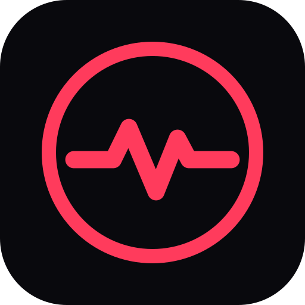</p>

<h1 align="center">Pulse</h1>
<p align="center"><b>Treino de força que segue o programa — offline primeiro, sincronizado em todo lugar, com um professor animado próprio.</b></p>

<p align="center">
  <a href="README.md">🇺🇸 Read in English</a> ·
  <a href="#demonstração">Demonstração</a> ·
  <a href="#arquitetura">Arquitetura</a> ·
  <a href="#uso-comercial">Uso comercial</a>
</p>

<p align="center">
  
  
  
  
  
  
</p>

---

O Pulse é um app instalável (PWA) para quem treina com programa. O programa (blocos, semanas, deload, supersets,
aquecimento, cardio e mobilidade) é escrito por um assistente de IA a partir de um contrato JSON documentado; o app
transforma isso no treino de hoje, registra cada série, explica cada exercício com uma animação 2D/3D própria e devolve os
resultados ao assistente para montar o próximo bloco.

> Todos os dados deste repositório e das imagens são fictícios (conta de demonstração: Rafael).

## Demonstração

<p align="center">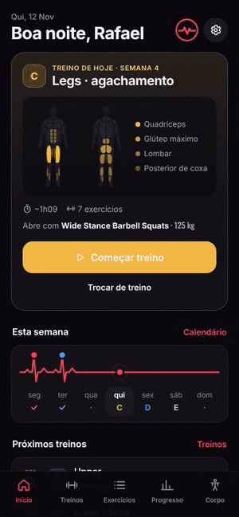</p>

| Início | Programa | Treino ativo | Exercício em 3D |
|---|---|---|---|
| 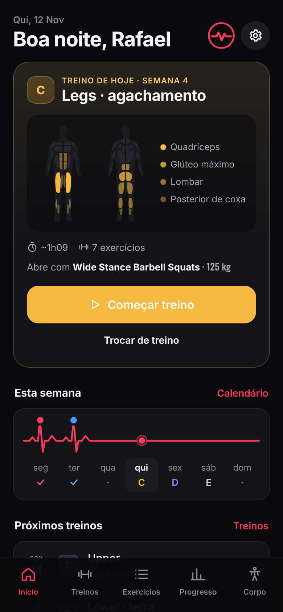 | 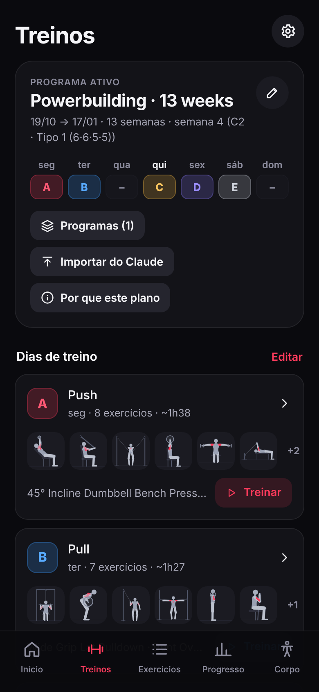 | 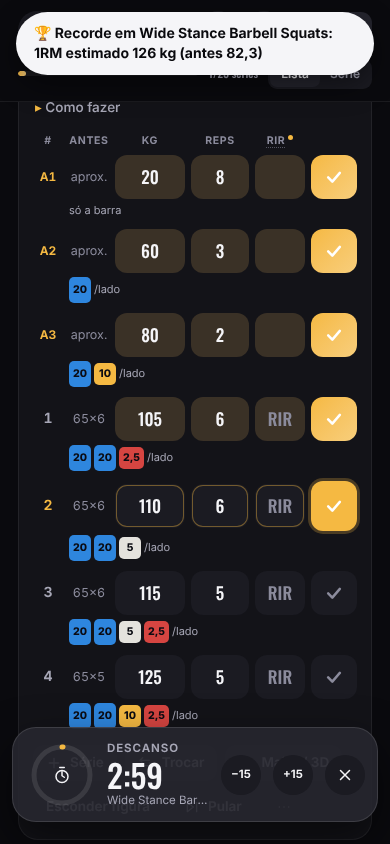 | 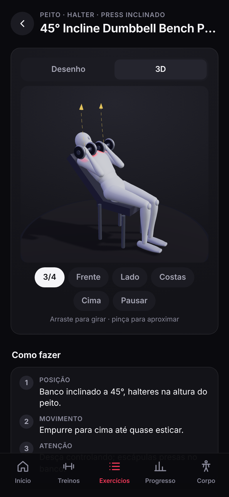 |

| Progresso | Composição corporal | Analisar com IA | Ajustes |
|---|---|---|---|
| 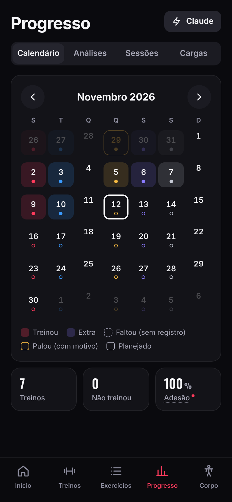 | 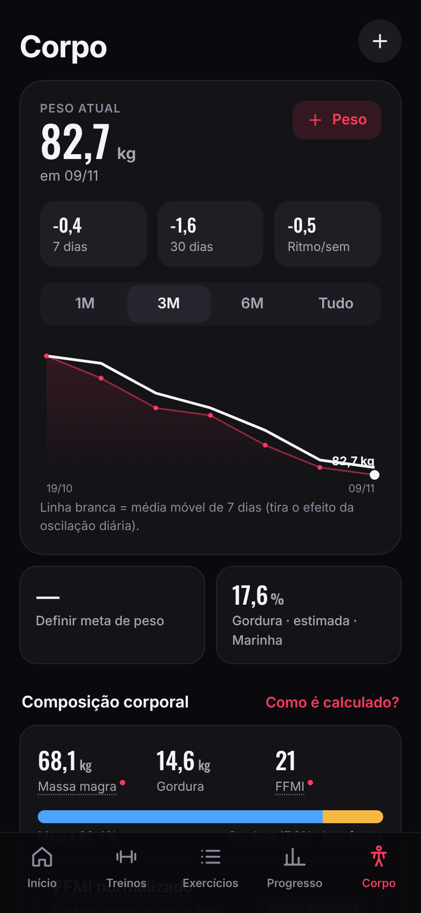 | 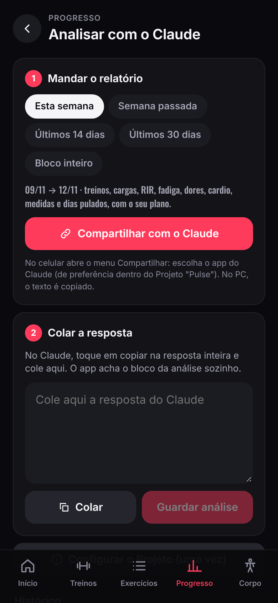 | 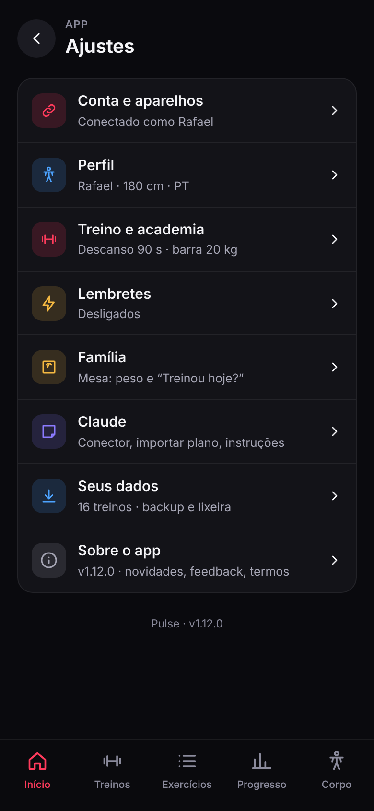 |

**No computador** — menu lateral, lista e detalhe lado a lado:

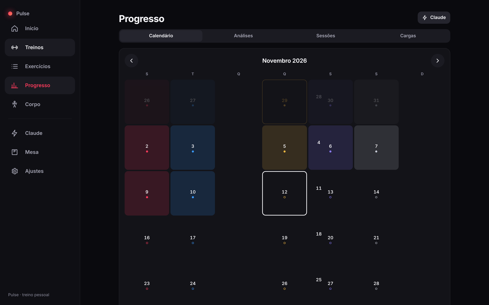

## O que faz

**Treino**
- O treino de hoje vem do programa ativo (divisão semanal ou rodízio), com a prescrição da semana: séries, repetições, RIR,
  descanso, deload, supersets (A1/A2), aquecimento, metas de cardio e blocos de mobilidade.
- Treino ativo: cronômetro de descanso, "igual à última", conta de anilhas da academia, modo lista ou uma série grande,
  troca de exercício por um substituto sugerido, notas, marcação de dor, recorde na hora (1RM estimado).
- Notificação ao vivo com o anel do descanso, o exercício da vez e os botões "série feita" / "+15 s" com o celular travado.

**Biblioteca de exercícios**
- Mais de 300 exercícios (força, mobilidade, cardio, Pilates, funcional) com "como fazer" em português e inglês.
- **Animações feitas no próprio app, sem mídia de terceiros:** boneco 2D articulado (cinemática inversa de dois ossos, ciclo
  da repetição por poses-chave, músculos em destaque) e uma vista **3D** (three.js) gerada dos mesmos dados de movimento,
  com giro, zoom e câmeras prontas.

**Progresso e corpo**
- Calendário (feito / faltou / pulou com motivo), adesão semanal, sequência, volume real por músculo contra a meta,
  comparação entre blocos, histórico de cargas por exercício.
- Corpo: peso com média móvel de 7 dias, medidas num mapa do corpo, % de gordura estimado (Marinha / RFM), massa magra, FFMI,
  fotos de progresso guardadas no servidor.

**IA no circuito, sem API paga**
- "Analisar com o Claude": compartilha um relatório estruturado do treino e guarda a análise colada.
- Um **conector MCP** deixa o Claude do próprio usuário ler o contexto de treino e publicar o próximo programa depois da
  validação e da aprovação do usuário.

**Contas e família**
- Contas privadas por pessoa, convites, passkeys (digital), entrada com um código de 6 letras gerado em outro aparelho.
- Sincronização offline primeiro de todas as tabelas, lixeira com restauração, migração segura da versão anterior do app.
- Ligação privada com a [Mesa](https://github.com/BeBernos/Mesa-Business) (alimentação da família): peso oficial único,
  "treinou hoje?", calorias do cardio e a agenda de treino.

## Arquitetura

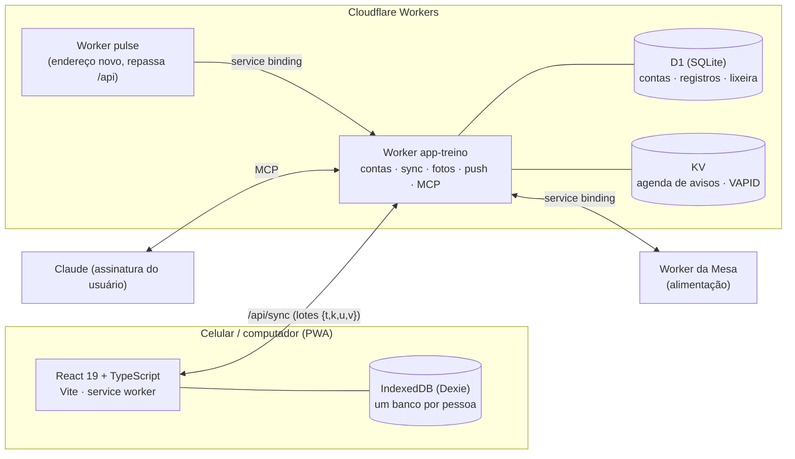

- **Cliente:** React 19 + TypeScript + Vite, rotas por hash, sem framework de CSS (tokens de design). Um middleware do Dexie
  carimba cada gravação e deixa lápide ao apagar, então a sincronização é "vence o carimbo maior" por registro.
- **Contrato do plano:** validado com Zod ([`docs/FORMATO-PLANO.md`](docs/FORMATO-PLANO.md)); formato da análise em
  [`docs/FORMATO-ANALISE.md`](docs/FORMATO-ANALISE.md).
- **Servidor:** Cloudflare Workers no plano grátis (≈10 ms de CPU por pedido): a senha é derivada no aparelho, WebAuthn
  conferido com SimpleWebAuthn, lembretes calculados no aparelho e disparados por um cron.
- **Idiomas:** português e inglês por conta; tudo o que vai para a IA fica em português, de propósito.

## Qualidade

- **506 testes** (Vitest): lógica de treino (calendário, prescrição, anilhas, análises, corpo), schema do plano, cobertura de
  tradução, dados de movimento de todos os exercícios, o Worker contra um D1 em memória sobre `node:sqlite` e o IndexedDB
  com `fake-indexeddb`.
- Roteiro de ponta a ponta com Playwright e autenticador virtual: migração, ativação da conta, passkey, convite e
  sincronização entre dois aparelhos, inclusive offline.
- `npm run ci` (testes + build de produção) é o comando usado no deploy.

## Rodar localmente

```bash
npm install
npm run dev            # só o app, http://localhost:5173
npm test               # 506 testes
npm run build          # dist/
npx wrangler dev --local --var PULSO_SETUP:escolha-um-codigo   # app + API em http://localhost:8787
```

## Uso comercial

Este repositório tem **código visível, mas não é open source**: dá para ler e avaliar o código, mas uso em produção ou
comercial exige licença. Há licenças para **implantações white-label** (academias, personal trainers, plataformas de
consultoria, bem-estar corporativo) e para desenvolvimento sob medida — inclusive o motor de animação dos exercícios. Veja a
[LICENSE](LICENSE) e fale comigo pelo [github.com/BeBernos](https://github.com/BeBernos).

## Faz parte de um conjunto

| | |
|---|---|
| [**Mesa**](https://github.com/BeBernos/Mesa-Business) | Plano alimentar da família, montado por IA |
| **Pulse** | Treino de força (este repositório) |
| [**Cesta**](https://github.com/BeBernos/Cesta-Business) | Pesquisa e comparação de preços de supermercado |
